# Individual project: fit set

### Description:

Fit Set is a web application for managing personal workout programs, tracking sets with smart timers, and planning daily nutrition. The platform provides an intuitive interface to organize exercises by days of the week, run workouts in manual or fully automated timer modes, build daily meal plans, and listen to background music with cloud synchronization for registered users.

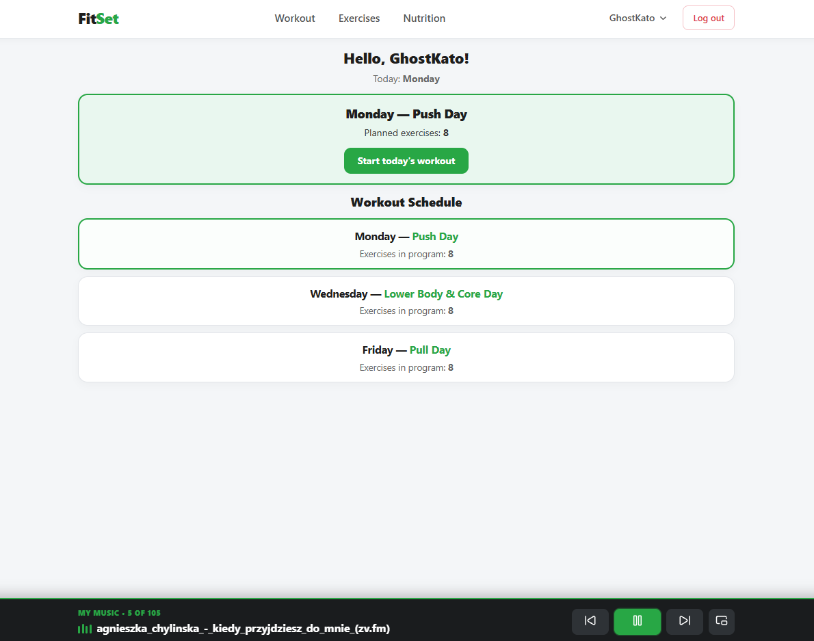

---

### Features:

1. **Authentication page:**
   - User registration with display name, email, and password (with show/hide password toggle).
   - Login and logout functionality with a confirmation modal.
   - Instant language switcher (EN, UA, RU) available directly on the authentication screen.

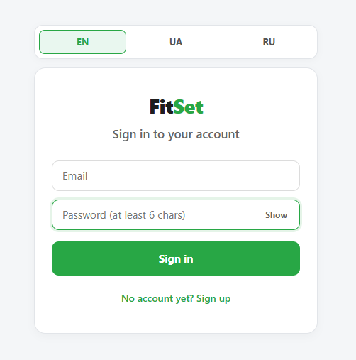

2. **Homepage:**
   - Personalized greeting with the current day of the week.
   - Workout notification board displaying today's scheduled workout theme and planned exercise count, or a rest and recovery day notice.
   - One-click start button that opens today's workout session.
   - Overview of the active weekly workout schedule with today's day highlighted.
   - Summary board of the selected meal plan for today with scheduled meal times and quick navigation to edit.

3. **Workout page (Manual & Automatic Modes):**
   - Interactive workout session filtered by the selected or current day of the week, with quick switching between exercises.
   - **Manual Mode:**
     - Untimed set execution (`In progress`) allowing the user to perform repetitions at their own pace with **Start Set**, **Finish Set**, and **Cancel** controls.
     - Automatically starts the rest countdown timer once a set is finished.
   - **Automatic Mode:**
     - Hands-free continuous workout cycle that automatically alternates between set execution timers and rest timers until the entire workout is complete, with **Start**, **Pause**, and **Continue** controls.
     - Per-exercise customizable work duration (default `40s`) for repetition-based exercises (`reps`), while time-based exercises (`sec`) automatically lock to their planned duration.
   - **Smart Rest & Audio System:**
     - Separate configurable rest timers for rest between sets (default `120s`) and rest between exercises (default `240s`), saved per day of the week in `localStorage`.
     - Automatic progression to the next exercise once all sets of the current exercise are completed.
     - Sequential set tracking pills (prevents accidental out-of-order toggling), per-exercise set reset, and a segmented overall workout progress bar.
     - Synthesized Web Audio API sound alerts (boosted via `GainNode`) for set start, 10-second and 5-second preparation warnings, set completion, exercise completion, and workout finish.

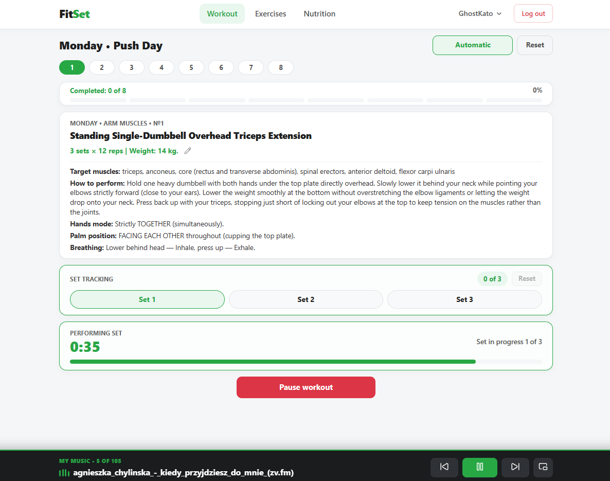

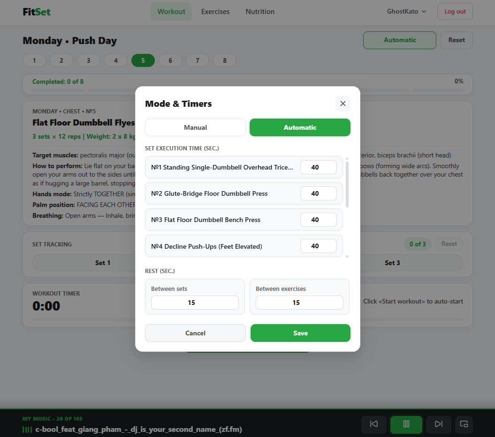

4. **Exercises page:**
   - Full CRUD management for personal exercises (create, edit, delete single or delete all with confirmation modal).
   - Detailed exercise cards displaying target muscles, step-by-step technique, hands mode (simultaneous or alternating), palm position, and breathing cues.
   - Multi-day assignment with independent exercise order numbers (`№`) for each day of the week.
   - Quick inline editing of working weight directly on the exercise card.
   - Active/inactive status toggle to temporarily hide exercises from workouts without deleting them.
   - Filtering tabs by day of the week, all active exercises, or inactive exercises.
   - One-click seeding of a pre-built multi-language starter workout program (Push, Pull, Lower Body & Core).

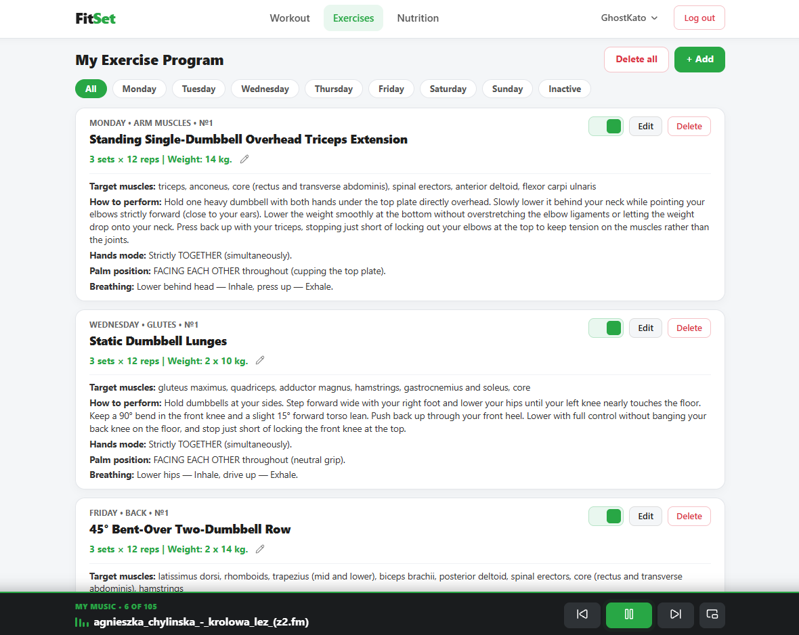

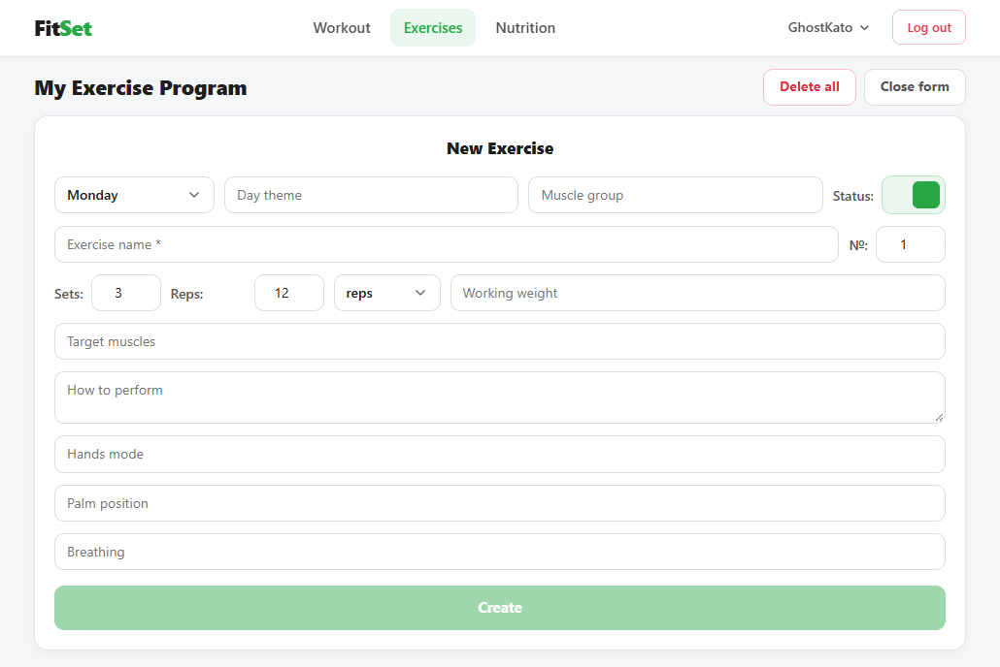

5. **Nutrition page:**
   - Structured food and meal database categorized into 8 groups: Simple Carbs, Complex Carbs, Protein, Fats, Fiber, Sauce, Shakes, and Dessert.
   - Full CRUD management for products, portions, preparation notes, and display order.
   - Interactive "My Meal Plan for Today" board allowing users to assign items to **Breakfast**, **Lunch**, or **Dinner** with optimistic UI updates.
   - Date-scoped daily selections (`userId_YYYY-MM-DD`) so each new day starts fresh automatically.
   - Editable meal schedule times (e.g., `8.00 – 9.00`) synced to the cloud.
   - One-click seeding of a pre-built default nutrition plan in the active language.

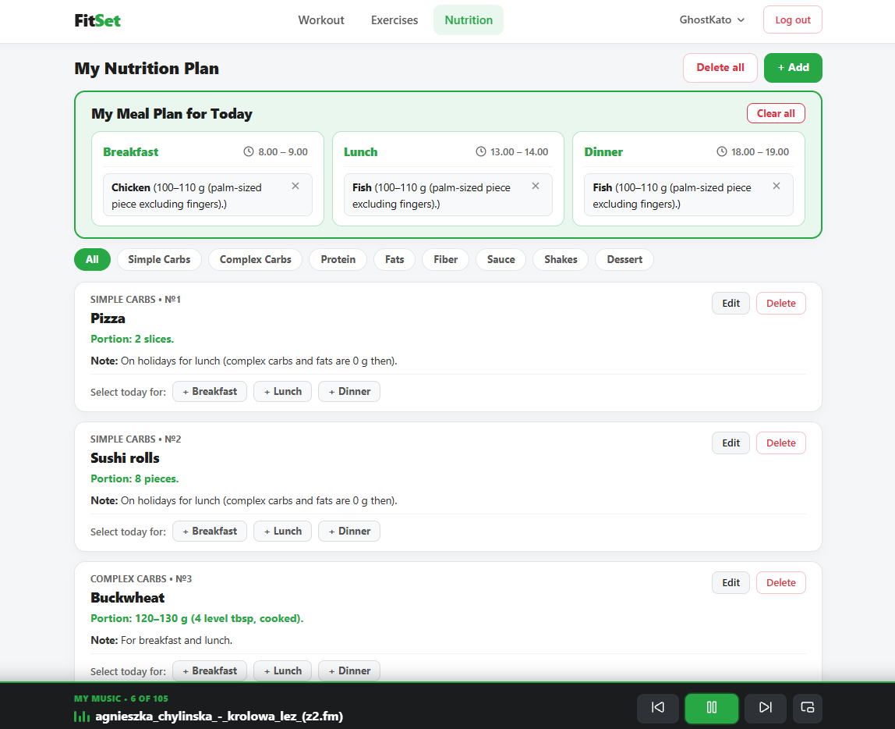

6. **Built-in Music Player:**
   - Persistent bottom audio player across all pages with a collapsible floating mini-pill mode and outside-click auto-minimize.
   - **Online Radio** mode featuring 8 preset electronic, synthwave, and gym radio streams.
   - **My Music** mode with automatic device detection: folder picker (`webkitdirectory`) on desktop and multi-file picker on mobile devices, supporting sequential and shuffle playback.
   - Animated equalizer and integration with the browser Media Session API for lock-screen and hardware media controls.

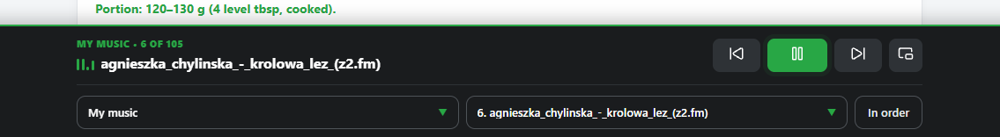

7. **Header, User Settings Menu & Modals:**
   - Navigation links for Workout, Exercises, and Nutrition, plus brand logo link to Homepage.
   - **Smart Theme System (Auto & Manual):**
     - **Auto by time (enabled by default):** Automatically activates **Light mode** during daytime (`07:00 – 20:00`) and switches to **Dark mode** at night (`20:00 – 07:00`), checking local time every 30 seconds for seamless live transitions without page reloads.
     - **Manual override:** Disabling auto-theme unlocks the manual Light/Dark switch and persists both preferences in `localStorage` (`data-theme` attribute).
   - Instant UI language switching between **English (EN)**, **Ukrainian (UA)**, and **Russian (RU)** persisted in `localStorage`.
   - Reusable confirmation modal (`Escape` key and backdrop click support) for destructive actions and account logout.

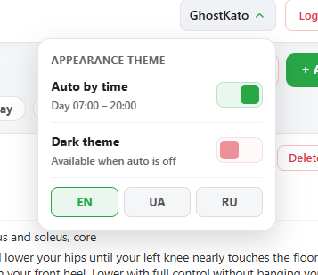

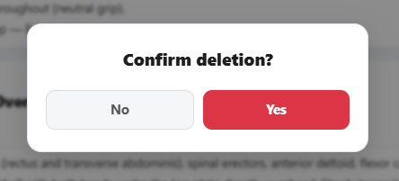

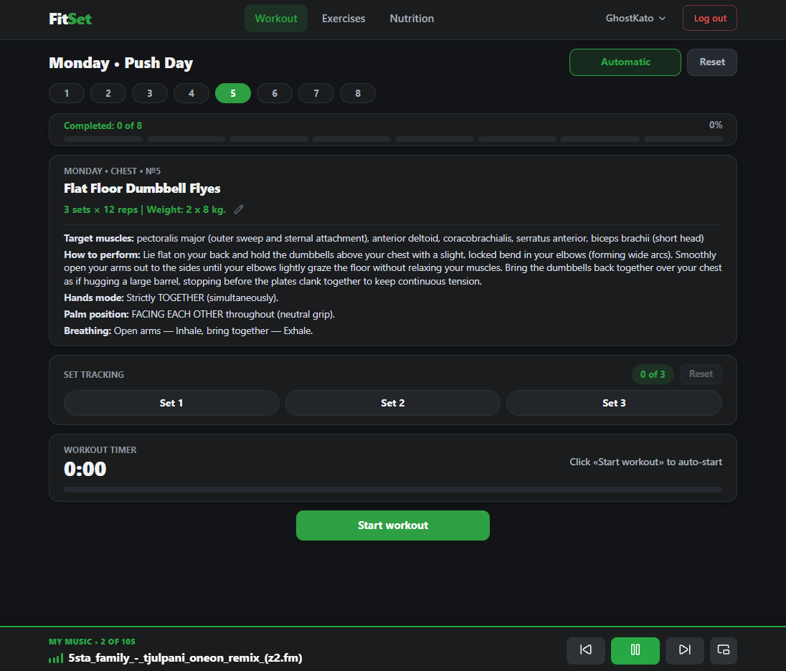

---

### Color coding:

- **Workout Timer & Progress:**
  - Green (`#28a745` / `#2ea043`) — active work phase, completed sets, and active navigation states
  - Blue (`#0d6efd` / `#4493f8`) — rest phase between sets or exercises
  - Red (`#dc3545` / `#e55353`) — final 10-second preparation countdown before the next set, inactive exercises, and destructive actions

---

### Stages of implementation:

1. **Interface design:**
   - Develop responsive layouts for authentication, homepage, workout session, exercise library, and nutrition planner.
   - Implement CSS custom properties for seamless Light and Dark themes, including dedicated ultrawide (`2200px+`) breakpoints.
   - Design persistent top navigation, collapsible bottom audio player, and reusable modals.

2. **Functionality development:**
   - Configure Firebase Authentication and Firestore collections for exercises, nutrition items, date-stamped daily meal selections, and meal schedules.
   - Build Redux Toolkit slices and async thunks with global overlay and silent background loading states.
   - Implement dual-mode Workout Timer state machine (`Manual` & `Automatic`) with Web Audio API synthesized sound cues and `localStorage` persistence.
   - Implement automatic time-based (`07:00 – 20:00`) and manual Light/Dark theme engine with live 30-second clock sync.
   - Develop custom multi-select dropdowns, status toggles, and confirmation modals.
   - Add multi-language localization (`EN`, `UA`, `RU`) and default data seeders.

3. **Testing:**
   - Verify manual and automatic workout timers, audio signals, and progress persistence across desktop and mobile viewports.
   - Test Firestore CRUD operations, optimistic UI updates, modal interactions, and automatic/manual theme switching.

4. **Launch and support:**
   - Build and deploy the production bundle via Vite.
   - Maintain and expand exercise templates, radio presets, and localization dictionaries.

---

### Advantages of using:

- Complete all-in-one fitness workspace combining workouts, rest timers, nutrition, and music.
- Choice between flexible **Manual** pacing and hands-free **Automatic** timer workouts with audio cues.
- Cloud synchronization of exercises, meal plans, and schedules via Firebase Firestore.
- Local persistence of active workout progress and per-day timer preferences in `localStorage`.
- One-click starter templates for both training programs and nutrition plans.
- Smart automatic time-based (`07:00 – 20:00`) or manual Light/Dark theme switching without page reloads.
- Full multi-language support (`EN`, `UA`, `RU`).
- Responsive and adaptive layout for mobile phones, tablets, desktops, and ultrawide (`2K/4K`) displays.

---

### Technologies used:

1. **Programming languages:**
   - **TypeScript**
   - **JavaScript (ES2022+)**

2. **Frameworks and Libraries:**
   - **React 19**
   - **Redux Toolkit** & **React Redux**
   - **React Router DOM v7**
   - **Lucide React** (icons)
   - **Modern Normalize**

3. **Databases & Storage:**
   - **Firebase Authentication** (user accounts and session management)
   - **Firebase Firestore** (cloud storage for exercises, nutrition items, daily meal selections, and meal schedules)

4. **Browser APIs & Audio:**
   - **Web Audio API** (synthesized WAV workout timer signals with `GainNode` amplification)
   - **Media Session API** (hardware/OS media controls for the built-in player)
   - **LocalStorage** (persisting workout progress, per-day timer configs, auto/manual theme, and language settings)

5. **Build Tools & Code Quality:**
   - **Vite**
   - **ESLint** & **TypeScript ESLint**

6. **Adaptability & Styling:**
   - **CSS Modules**
   - **CSS Custom Properties (Variables)** for Light/Dark theming
   - **CSS Media Queries** (including `2200px+` ultrawide support), **Flexbox**, and **CSS Grid**

---

Fit Set provides a streamlined and distraction-free environment for planning workouts, tracking sets in manual or automatic mode, and organizing daily meals. Cloud synchronization, synthesized timer alerts, automatic day/night theming, and an integrated audio player ensure a smooth training experience across all devices.
