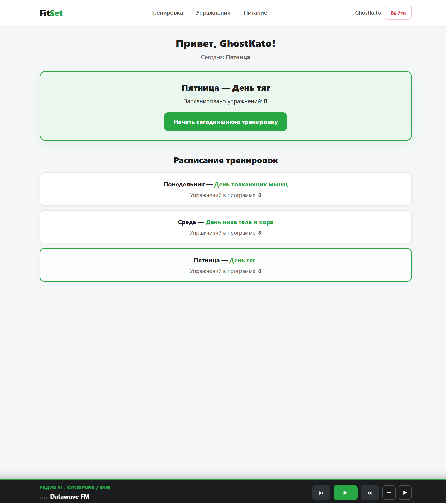
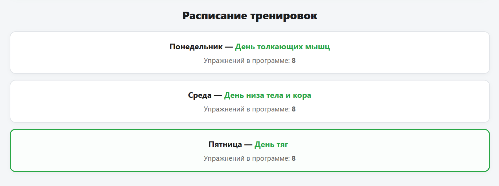
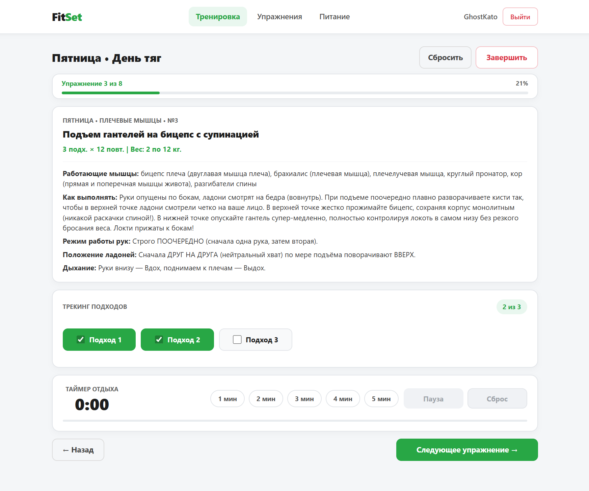
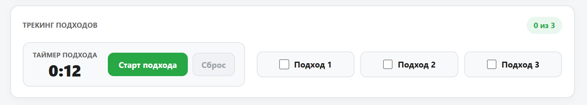
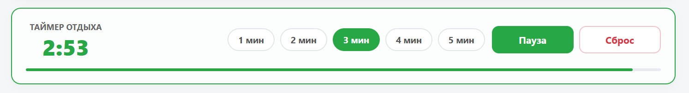
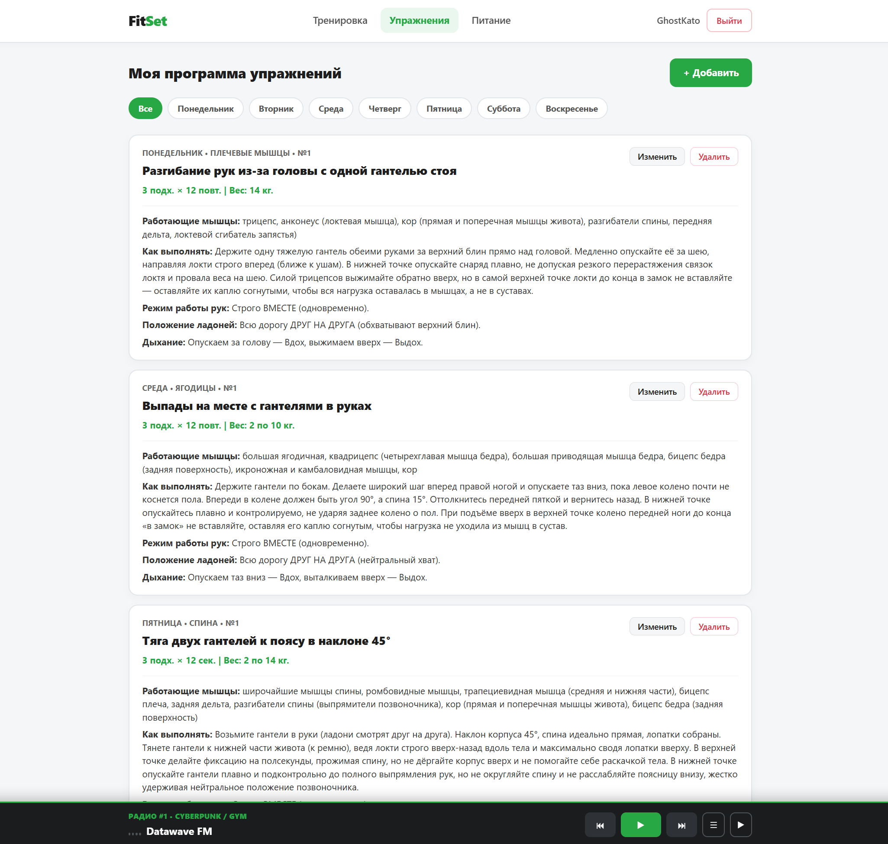
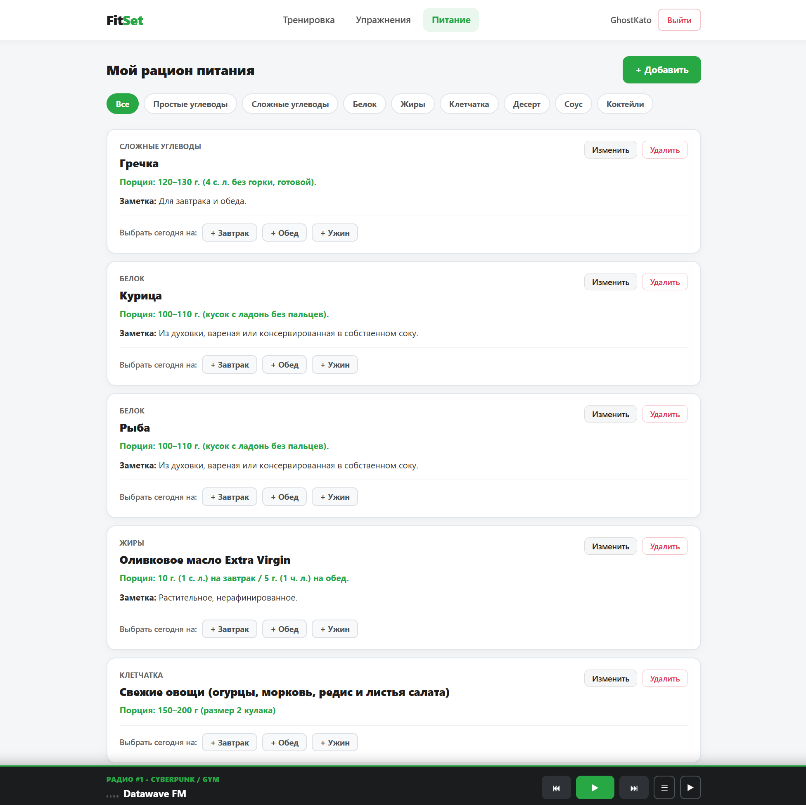
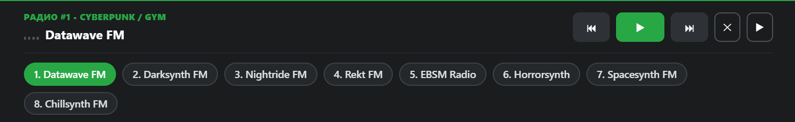

# Individual project: fit set

### Description:

Fit Set is a web application for planning workouts, tracking exercises in real time, and managing daily nutrition. The platform provides an intuitive interface to organize weekly training splits, track sets and timed intervals, monitor rest periods, and listen to background workout radio—all in one place.

---

### Features:

1. **Homepage:**
   - Overview of the weekly training schedule and quick access to today's workout.
   - Summary of daily fitness and nutrition progress.
   - Opens on site launch or when clicking the FitSet logo.

2. **Workout page:**
   - Step-by-step execution of exercises scheduled for the selected day of the week (with support for custom workout day titles).
   - Clean workout progress bar displaying the current exercise index and overall completion percentage.
   - Automatic progress persistence in `LocalStorage` per day, plus **Reset** and **Finish** controls.
   - Navigation between exercises (**Previous** / **Next exercise**).

3. **Set Tracker & Timed Exercises:**
   - Interactive set checkboxes supporting both repetition-based (`reps`) and time-based (`sec`) exercises.
   - Built-in countdown set timer with **Start**, **Pause**, and **Reset** controls that automatically marks the current set as completed when time expires.
   - Cross-platform audio alerts synthesized via Base64 WAV and Web Audio API.

4. **Rest Timer:**
   - Dedicated rest interval timer with quick-select presets (`1 min` to `5 min`).
   - Visual countdown progress bar and audio notification when rest time is over.

5. **Exercises page:**
   - Full workout program builder to create, edit, reorder, and delete exercises by day of the week.
   - Customizable parameters for sets, target reps or seconds, working weight, and custom day titles.

6. **Nutrition page:**
   - Daily calorie and macronutrient tracking (proteins, fats, carbohydrates).
   - Meal logging and daily nutrition goal monitoring.

7. **Persistent Music Player:**
   - Built-in dark-themed audio player docked at the bottom of the screen with radio station switching and an animated equalizer.
   - Collapsible into a compact floating equalizer pill in the bottom-right corner so it never blocks workout controls.

8. **Site menu & User Account:**
   - User authentication (login, registration, logout).
   - Quick navigation across **Workout**, **Exercises**, and **Nutrition** sections.
   - Seamless data synchronization and local fallback storage.

---

### Color coding:

- **Active & Completed States:**
  - Green (`#28a745`) — completed sets, active timers, progress bar fill, and active station indicators
  - Light Green (`#e9f7ef`) — active timer highlight and progress badges
- **Reset & Exit Actions:**
  - Red (`#dc3545`) — finishing a workout, resetting timers, or logging out
- **Neutral Surfaces:**
  - Light Gray (`#f8f9fa`) & White (`#ffffff`) — high-contrast workout cards for easy readability in the gym
  - Dark Charcoal (`#1a1c1e`) — persistent bottom music player

---

### Stages of implementation:

1. **Interface design:**
   - Designed clean, high-contrast layouts for the Homepage, Workout, Exercises, Nutrition, and persistent Music Player.
   - Established a consistent visual rhythm, typography, and green/neutral color palette.
   - Created responsive layouts for desktop, tablet, and mobile devices.

2. **Functionality development:**
   - Built global state management with Redux Toolkit for exercises and user data.
   - Implemented the interactive Workout flow with `LocalStorage` progress persistence.
   - Engineered dual timers (`SetTracker` and `RestTimer`) with cross-platform Base64 WAV + Web Audio API sound synthesis.
   - Added smooth CSS keyframe animations for the progress indicators and music equalizer.
   - Integrated user authentication and cloud data storage.

3. **Testing:**
   - Tested timer accuracy, audio playback, and layout stability across desktop and mobile viewports.
   - Verified `LocalStorage` persistence, page reloads, and `React.StrictMode` lifecycle safety.

4. **Launch and support:**
   - Deployed the application and refined UI responsiveness based on real workout usage.

---

### Advantages of using:

- All-in-one tool combining workout tracking, rest timers, nutrition logging, and background music.
- Support for both rep-based and timed exercises with automatic set completion.
- Reliable audio alerts that work across desktop and mobile browsers without external audio files.
- Automatic `LocalStorage` backup during workouts so progress is never lost on page refresh.
- Clean visual progress indicators and animated music equalizer.
- Fully responsive design tailored for one-handed use on a smartphone in the gym.

---

### Technologies used:

1. **Programming languages:**
   - **TypeScript**
   - **JavaScript**

2. **Frameworks and Libraries:**
   - **React**
   - **React Router**
   - **Redux Toolkit**

3. **Build Tools & Version Control:**
   - **Vite**
   - **Git**

4. **Storage & Authentication:**
   - **Firebase** (Authentication & Database)
   - **LocalStorage** (real-time workout progress persistence)

5. **Browser APIs:**
   - **Web Audio API** & **HTML5 Audio** (Base64 WAV synthesis for timer alerts and streaming radio)

6. **Styling & Adaptability:**
   - **CSS Modules**
   - **CSS Grid & Flexbox**
   - **CSS Keyframe Animations**
   - **CSS Media Queries**

---

Fit Set provides a fast, reliable, and motivating platform for managing daily workouts and nutrition. With built-in timers, persistent progress tracking, and an integrated music player, it delivers a smooth experience across all devices.
